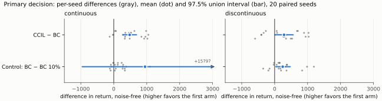
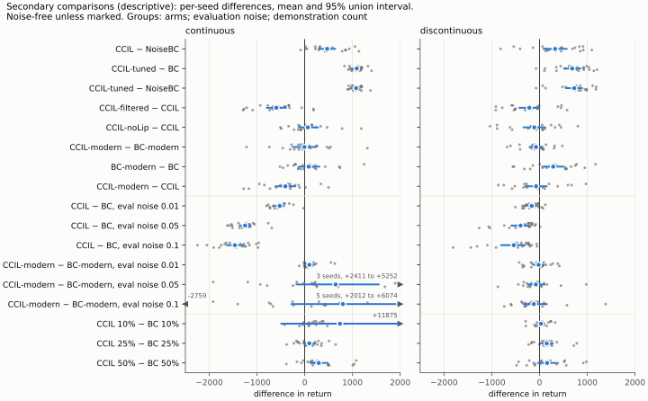
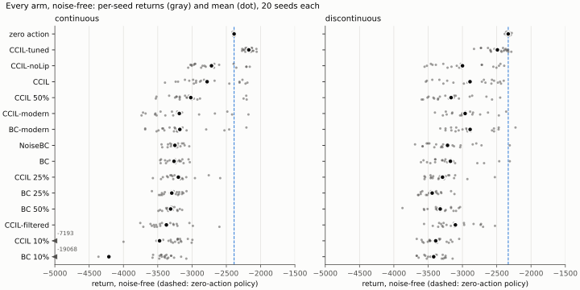
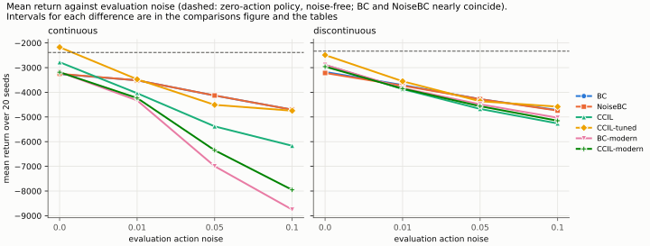

# Pendulum CCIL efficacy study: results (#25)

This reports the study predeclared in
[`pendulum-ccil-study-predeclaration.md`](pendulum-ccil-study-predeclaration.md),
version 6, exactly as predeclared. Every number below comes from the tables in
[`pendulum-ccil-study-tables.md`](pendulum-ccil-study-tables.md). Those are
generated from the committed analysis and records, and each per-seed value
links to the record it came from.

## Answer

On both Pendulum tasks, the predeclared primary outcome is **CCIL improves on
BC**. The comparison is noise-free, over 20 training seeds, with a Bonferroni
97.5% union interval.

| Task | CCIL − BC, mean | 97.5% union interval | Relative to \|BC\| | Positive control |
|---|---|---|---|---|
| Continuous | +482 | [274, 690] | +14.8% [9.2%, 20.3%] | fails |
| Discontinuous | +286 | [8, 563] | +9.0% [1.0%, 16.2%] | passes |

- **What the primary measures.** It is the effect of the paper's complete
  augmentation recipe under the paper's training settings: 20 noisy-action
  labels per demonstrated transition (K = 20), added to the demonstrations,
  and trained for the paper's fixed 100 epochs. It does not establish that
  K = 20 is the best number of labels, or which part of the recipe produces
  the effect.
- The discontinuous lower endpoint is close to zero, at +8.
- **The positive control** compares BC on all episodes with BC on 10% of them.
  It fails on continuous because one BC-on-10% policy (seed 1209) returned
  −19068, against a mean of −4213 for that arm. That one seed makes the paired-t
  interval [−957, 2857] cross zero, while the BCa interval [119, 5382] does not.
  The union therefore contains zero.
- **What a failed control means here.** Under §8 the control only governs how
  a *null* primary result is read. A directional primary result stands either
  way. So the continuous outcome is unaffected, and the failure is reported as
  required.
- **Integrity.** There were no algorithmic failures, no infrastructure faults
  and no exclusions. Every rollout was re-audited (1920 of them).

## What was run

- **Design.** The runner plan `tools/m3_experiments/pendulum_v6.yaml` defines
  120 tuning units on seeds 11–13 and 600 study units on seeds 1201–1220. Each
  study unit is one task, arm and seed.
- **Code.** The frozen commit is `6fbcce5`, recorded in
  `tools/m3_experiments/freeze.json`; it was run from main at `d4ef5d1`. The
  freeze evidence is in §11 of the predeclaration.
- **Execution.**
  - One Linux host with two NVIDIA RTX PRO 6000 Blackwell GPUs.
  - torch 2.14.1+cu130, numpy 2.4.6, scipy 1.16.3.
  - The script is [`run/study.sh`](../fixtures/evidence/pendulum-study-v6/run/study.sh),
    and the step log is [`run/study.log`](../fixtures/evidence/pendulum-study-v6/run/study.log).
  - Wall time was 56 minutes: tuning 13.5, choice and deferred returns 1,
    study 40, verify 1 and analysis 1.
- **Tuning choice.** The predeclared rules chose the following on both tasks:
  - NoiseBC: 1e-3.
  - CCIL-tuned: action noise 0.3, again the top of its grid.
  - BC-modern and CCIL-modern: learning rate 1e-2 on continuous and 3e-3 on
    discontinuous.

  The full tables are in the tables file.

## Secondary results (descriptive)

These comparisons use 95% union intervals. They make no decisions and no
multiplicity claims (§8). Each one is described under its own training
procedure.

- **CCIL − NoiseBC:** +469 [299, 640] on continuous and +328 [83, 572] on
  discontinuous.
- **CCIL-tuned** is the strongest arm on both tasks. It is +1090
  [1024, 1156] over BC on continuous and +685 [512, 857] on discontinuous.
- **Filtering hurts:** CCIL-filtered − CCIL is −593 [−795, −392] on
  continuous and −213 [−425, −1] on discontinuous.
- **CCIL-noLip − CCIL:** the intervals contain zero on both tasks, at +64
  [−125, 278] and −110 [−337, 117].
- **Evaluation noise, paper settings.** CCIL − BC is negative at every
  evaluation noise level on both tasks:
  - continuous: −524, −1249 and −1464 at noise 0.01, 0.05 and 0.1;
  - discontinuous: −163, −397 and −539.

  Under the paper's training settings, CCIL's noise-free advantage does not
  survive action noise at evaluation.

  
- **Modern training settings.** BC-modern and CCIL-modern use a different
  procedure:
  - AdamW;
  - the same 50,000 optimizer steps for both arms;
  - the EMA checkpoint with the lowest validation loss on held-out episodes;
  - the learning rate tuned on validation loss only (§6).

  Under that procedure:
  - Noise-free, CCIL-modern − BC-modern contains zero on both tasks: −7
    [−251, 236] and −73 [−210, 64].
  - With evaluation noise, it is +96 [9, 209] on continuous at noise 0.01, and
    contains zero at every other level on both tasks.
  - BC-modern − BC is +287 [63, 511] on discontinuous, and contains zero on
    continuous.
  - CCIL-modern − CCIL is −405 [−614, −196] on continuous, and contains zero
    on discontinuous.

  These results describe the augmentation under the modern procedure. They
  neither qualify nor overturn the primary result, which concerns the paper's
  procedure.
- **Data size.** CCIL − BC is positive at 50% of the demonstrations on
  continuous (+294 [112, 481]) and at 25% on discontinuous (+151 [30, 281]).
  The other fractions contain zero.
- **Zero-action reference.** Every arm returns less than the zero-action
  policy, except CCIL-tuned on continuous, which is +214 [181, 247] above it.
  Applying no torque outperforms most learned policies on this task. Absolute
  returns should be read in that light.
- **Label accuracy.**
  - Continuous: every candidate label was accepted.
  - Discontinuous: the lowest per-seed acceptance rate of each CCIL arm was 0.73–0.86, except the
    noLip ablation at 0.10.
  - Mean true one-step label error: about 4e-3 (continuous) and 3e-3
    (discontinuous), in raw state units.

## Paper comparison (informational)

| Task | BC: paper | BC: this study | CCIL: paper | CCIL: this study |
|---|---|---|---|---|
| Continuous | −3244 | −3262 ± 129 | −2269 | −2780 ± 368 |
| Discontinuous | −3204 | −3175 ± 355 | −2556 | −2889 ± 390 |

BC matches the paper's values closely. CCIL improves on BC in the same
direction as the paper, but by less. The paper used different seeds and the
legacy implementation. Under the #23 corrected configuration, this study runs
the corrected implementation (#21, #22). No agreement or disagreement is
claimed beyond what the intervals show.

It is unknown which configuration produced the paper's values. On
discontinuous Pendulum, `main`'s configuration uses `noisy_action` labels,
and the `label-filtering` branch uses `backward_euler_fast` labels with
filtering at quantile 0.3. No record ties either one to Fig. 4(c). This study
uses `main`'s configurations, converted by #23. Label filtering is tested
separately, as the CCIL-filtered arm. The migration ledger records this in
`sim-pendulum-cont`, `sim-pendulum-disc` and
`internal-label-filtering-configs`.

## Version 4 (incomplete and superseded)

Version 4's tuning tables, its choice and its 21 completed study units are
reported separately at the end of the tables file. They are disclosed in the
predeclaration's History and are never mixed with version 6's.

## Records and reproduction

- **Records.** Each study and tuning unit's record is in
  [`docs/fixtures/evidence/pendulum-study-v6/results/`](../fixtures/evidence/pendulum-study-v6/results/).
  A record holds:
  - the returns per noise level, with each rollout's sha256 and audit result;
  - the resolved configuration;
  - the code-state gate, with both commits;
  - the package versions and the GPU;
  - label accuracy and the training summary.

  The run manifests of every stage are under `stages/`, and the input
  manifests under `inputs/`. Host paths are redacted to `<root>` and `<repo>`.
- **Not committed.** The rollouts and checkpoints (95 GB) are not committed;
  each is identified by its sha256 in the records.
- **Regenerate the tables.** Run `python tools/pendulum_report/report.py
  --check`. It exits 0 if the committed tables equal a regeneration from the
  committed analysis and records.
- **Regenerate the figures.** Run `uv run --group evidence python
  tools/pendulum_report/plots.py --check`. It exits 0 if the committed SVGs in
  [`figures/`](figures/) equal a regeneration. The figures plot only values
  from `analysis.json`, the same input as the tables, whose per-seed values
  link to the records.
- **Rerun the study.** Check out `d4ef5d1`, the commit the study ran from,
  and run `tools/m3_experiments/run_study.py` with the steps `tuning`,
  `choose`, `returns`, `study` and `verify`, then `analyze_v6.py` (see
  [`run/study.sh`](../fixtures/evidence/pendulum-study-v6/run/study.sh)). It
  needs a CUDA GPU.
- **The gate.** `d4ef5d1` carries the freeze manifest, and its tooling equals
  the frozen `6fbcce5`. The frozen-tooling gate refuses any code state whose
  study tooling differs. That includes later commits on `main`: #140 changed
  `tools/m3_experiments/freeze_evidence.sh`, which is a frozen path.

## Limitations

- **Scope.** There are two tasks and 20 seeds per arm. All the results are on
  the Pendulum swing-up environment of the paper.
- **The control.** The continuous positive control failed. The study did not
  show on that task that it detects the known BC data-size difference.
- **Noise.** Under the paper's training settings, CCIL's advantage is
  noise-free only (above).
- **The amount of augmentation.** The study tests one recipe, K = 20 labels
  per transition. How the effect depends on the amount of synthetic data, the
  real-data fraction and the training exposure is a separate question. It
  belongs to personalrobotics/il-supervision-benchmarks#1, on the shared
  harness of personalrobotics/il-supervision-benchmarks#11.
- **Paper comparison.** The study does not reproduce the legacy
  implementation's numbers, which was withdrawn before any run (#101).
