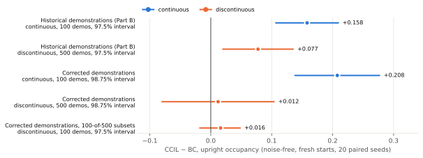
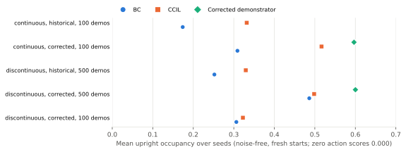

# Pendulum CCIL: M3 closeout (#24, #25)

This report closes the Pendulum program of milestone M3. It is a synthesis of committed evidence: nothing was trained or evaluated for it. Every number comes from the generated tables in [`pendulum-m3-tables.md`](pendulum-m3-tables.md) (T1–T7). Each table names the committed report it reads.

## Conclusion

- **CCIL can improve balance behavior on Pendulum.** On fresh evaluation starts, CCIL raised upright occupancy over BC in the predeclared historical validation on both tasks, and in the corrected-demonstrator study on the continuous task.
- **The effect is strong on continuous Pendulum under the corrected study.** CCIL − BC in upright occupancy is +0.208 [0.138, 0.277] at 98.75%. CCIL also held the pole upright through the final two seconds far more often than BC (0.702 against 0.032).
- **No advantage was detected on discontinuous Pendulum** under the corrected study: +0.012 [−0.080, 0.104] at 98.75%.
- **Matching the nominal demonstration count did not explain that task difference.** On discontinuous Pendulum with 100 demonstrations, the same count as the continuous task, CCIL − BC is +0.016 [−0.018, 0.048] at 97.5%. The change from 500 demonstrations is +0.004 [−0.076, 0.085]: no change was detected.
- **These studies do not identify the discontinuity as the cause,** and they do not establish that the effect generalizes beyond these two Pendulum tasks.



*Figure 1. Each row is one predeclared estimate, with its own interval level. The values are in T2.*

## What was done, in order

1. **Version 6 study under the legacy return** (#24; [`pendulum-ccil-study-results.md`](pendulum-ccil-study-results.md)).
   - **Design:** predeclared on the modern stack, with BC, NoiseBC, CCIL and ablations, 20 seeds per arm.
   - **Result:** CCIL improved on BC in the legacy quadratic return on both tasks (T1).
   - **Why it was not the end:** under that return, applying no torque outscored nearly every learned policy. The return rewards staying still near the bottom, so it is a defective measure of swing-up.
2. **Task-aligned metrics** (#143; `docs/experiments/pendulum-eval-v2-predeclaration.md`, profile `pendulum_swingup_v2`).
   - **Primary metric:** upright occupancy, the fraction of steps within 8° of vertical, which is `dm_control`'s swing-up criterion. Zero action scores 0.
   - **Secondary metrics:** normalized height, a final two-second hold, and behavior diagnostics.
   - **The legacy return** is kept as a named historical profile.
3. **Historical rescoring** (T2).
   - **Part A** rescored all 1,440 stored v6 rollouts, post hoc.
   - **Part B** evaluated the frozen v6 checkpoints on predeclared fresh starts.
   - **Result:** both found CCIL above BC in occupancy on both tasks, and Part B's positive control passed on both.
4. **The historical demonstrator defect** (T6). An attempt to reconstruct the historical demonstrator failed, and the diagnosis found a wrapping inconsistency:
   - The LQR window was tested on the angle wrapped to [0, 2π), but the LQR term used the raw atan2 angle.
   - On one side of upright the controller therefore saturates at +3 instead of balancing.
   - The historical demonstrations contain those saturated actions.
   - The reconstruction was terminated (revision 2 of the evaluation predeclaration).
5. **Corrected-demonstrator study** (`docs/experiments/pendulum-corrected-demonstrator-predeclaration.md`).
   - **Change:** one consistent wrapped angle, with everything else as historical: starts, episode counts, dynamics, and v6's training settings.
   - **Design:** BC and CCIL were retrained on the corrected demonstrations and evaluated on the Part B starts.
   - **Result:** see the Conclusion and T2. Neither task showed a detectable change in CCIL − BC relative to the historical study (T2, paired changes).
6. **Demonstration-count study** (`docs/experiments/pendulum-demonstration-count-predeclaration.md`).
   - **Design:** discontinuous only. Each seed trains on its own random 100-of-500 subset, shared by BC and CCIL.
   - **Framing:** a follow-up to the corrected discontinuous result, planned after that result had been seen.
   - **Result:** see the Conclusion and T2.



*Figure 2. Mean over 20 seeds. Zero action scores 0.000 in every condition. The values are in T3.*

## Findings beyond the primary outcomes

**Both arms improve with corrected demonstrations** (95%, descriptive).
- BC gained +0.135 on continuous and +0.234 on discontinuous in occupancy.
- CCIL gained +0.185 and +0.169.
- On discontinuous, BC's larger gain closed most of the historical gap. With 100 demonstrations, both arms lose occupancy, with similar point estimates: BC −0.180, CCIL −0.176. The equivalence of those losses was not tested.

**Evaluation noise, with the two channels separated** (T4).
- **The channels pull opposite ways.** CCIL − BC is positive under action-only noise and negative under observation-only noise, in both the historical and the corrected study.
- **v6 applied both channels at once,** and its CCIL − BC under noise was negative in the legacy return. Separated, the action channel favors CCIL and the observation channel favors BC.
- **No robustness claim follows.** The observation mixture blends the true state with a uniform sample. It is not a physically scaled sensor model.

**Action bound** (T5).
- **Frequency:** the CCIL arms of these studies command actions beyond ±3 on about 18–20% of noise-free steps. BC never does.
- **Size:** the excess is at most 5.4e-4 in the historical study.
- **Source:** it comes from each CCIL checkpoint's action scaler, fitted to label actions just beyond ±3.
- **Clipped re-evaluation:** clipping to ±3 and re-evaluating every historical Part B unit leaves the primary outcomes unchanged. The largest per-seed change in any arm's occupancy is 0.027.

**Label accuracy.** CCIL's corrective labels were checked against the true one-step dynamics.
- **Error:** the mean true one-step error is about 2e-3 in raw state units on discontinuous.
- **Acceptance:** 0.89 at 100 demonstrations and 0.88 at 500.
- **No difference between 100 and 500 demonstrations** was detected in either quantity (`pendulum-demonstration-count/study-evaluate.json`).

## What this does not establish

- **That the discontinuity causes the task difference.** The two tasks also differ in their demonstration starts, and the demonstration-count study varies only the count.
- **Anything about the modern recipe on corrected data.** The corrected and demonstration-count studies trained the paper's recipe only. On the historical data, the modern recipe showed no detectable CCIL − BC difference (Part B, descriptive).
- **Robustness.** The noise model is not physically scaled.
- **Generality.** The studies cover one environment, one demonstrator family and one learner. External benchmarks are separate work.
- **A reproduction of the paper's numbers.** See the next section.

## Why exact legacy reproduction was withdrawn

Issue #3 asked why the released scripts do not reproduce Fig. 4(c). The legacy-parity study was withdrawn before any run, by the migration contract amendment of 2026-10-26 (§5, #101).

**Why:**
- **The legacy stack can no longer be rebuilt for current hardware.** It needs torch 2.1, which cannot use the current GPUs; the lab's d3rlpy fork; and gym 0.19, which no longer builds.
- **The modern implementation intentionally corrects defects** in the legacy label and dynamics code (#21, #22). These corrections are properties of the implementation under test, and each ported stage is verified against the legacy code on fixtures.
- **The released configuration that produced Fig. 4(c) is unknown.** The `label-filtering` branch changes the discontinuous configuration, and nothing records which version produced the figure.

**What replaced it:** a test of the paper's claim itself (does CCIL help on Pendulum?) on the modern stack, with predeclared designs, fresh evaluation starts and task-aligned metrics. Under the legacy return, v6's BC matches the paper's BC closely, and CCIL improves on BC in the same direction as the paper but by less (T1; [`pendulum-ccil-study-results.md`](pendulum-ccil-study-results.md)).

## Reproduction

**Regenerate this report's tables and figures** from the committed evidence:

```bash
uv run --group evidence python tools/pendulum_report/closeout.py --check   # exit 0: tables and figures are current
```

T7 lists the sha256 of every evidence file read. Rollouts and checkpoints are not committed; each is identified by its sha256 inside those reports.

**Rerun the studies.** Each step runs the frozen-tooling gate and refuses any other code state. The prefix is `R="uv run --group evidence --with-requirements tools/vector_env/requirements.txt python"`.

| Study | Frozen at | Commands |
|---|---|---|
| v6 (legacy return) | ccil `6fbcce5`, run from `d4ef5d1` | `docs/fixtures/evidence/pendulum-study-v6/run/study.sh` (`tools/m3_experiments/run_study.py` tuning, choose, returns, study, verify; then `analyze_v6.py`) |
| Historical Parts A and B | `70e25a4` (Part B) | `$R tools/pendulum_eval/historical.py part-a --root V6_ROOT`; `... part-b --root V6_ROOT --out NEW_DIR`; audit: `tools/pendulum_eval/audit_part_b.py`; clipping: `tools/pendulum_eval/clip_sensitivity.py` |
| Demonstrator diagnosis | | `$R tools/pendulum_eval/expert_validation.py --check`; `$R tools/pendulum_eval/expert_diagnosis.py --check` |
| Corrected demonstrations | `1849ebb` | `tools/pendulum_eval/corrected_demos.py accept`, `generate --out DIR`, `replay --data DIR --expect REPORT`. The canonical datasets are assets of the prerelease `data/pendulum-corrected-demonstrator-v1`, listed by sha256 in `canonical-datasets.json`. |
| Corrected study | ccil `6fbcce5`, tooling `19789fb` | `$R tools/pendulum_eval/corrected_study.py preflight --root NEW --data DATASETS --v6 V6_ROOT`, then `train`, `audit`, `evaluate`; then `tools/pendulum_eval/audit_corrected_evaluate.py` |
| Demonstration count | ccil `6fbcce5`, tooling `b4bd81e` | `$R tools/pendulum_eval/count_study.py preflight --root NEW --data DATASETS --v6 V6_ROOT --corrected CORRECTED_ROOT`, then `train`, `audit`, `evaluate`; then `tools/pendulum_eval/audit_count_evaluate.py` |

Each study's `study-smoke.json` records the whole sequence on reduced seeds, including the refusals: wrong datasets, out-of-order steps, and corrupted artifacts.

**Integrity.**
- **Before each study's evaluation:** an audit traced every stage to the canonical inputs. No run ID or `.npz` numerical artifact was shared with an earlier study.
- **After each study's evaluation:** a read-only audit reopened every saved rollout and reconstructed the report exactly.
- **The audits fail closed:** a corrupted rollout or an altered report value makes them fail.

## Ledger

The Pendulum entries of [`docs/ledger/ledger.json`](../ledger/ledger.json) now point here:
- **`sim-pendulum-cont` and `sim-pendulum-disc`:** stay out of scope as legacy reproductions. Their claim is answered by this report.
- **`internal-label-filtering-configs`:** out of scope. Which configuration produced Fig. 4(c) is recorded as unknown.
- **`internal-action-chunking-labels`:** out of scope. Chunked labels were ported with fixture evidence in #22, and the real-robot claim is cited as published.
- **`sim-pendulum-label-bound`:** still blocked, because its procedure is unrecorded. It moves to M7, where the Pendulum oracle (#145) measures label error against exact dynamics.
